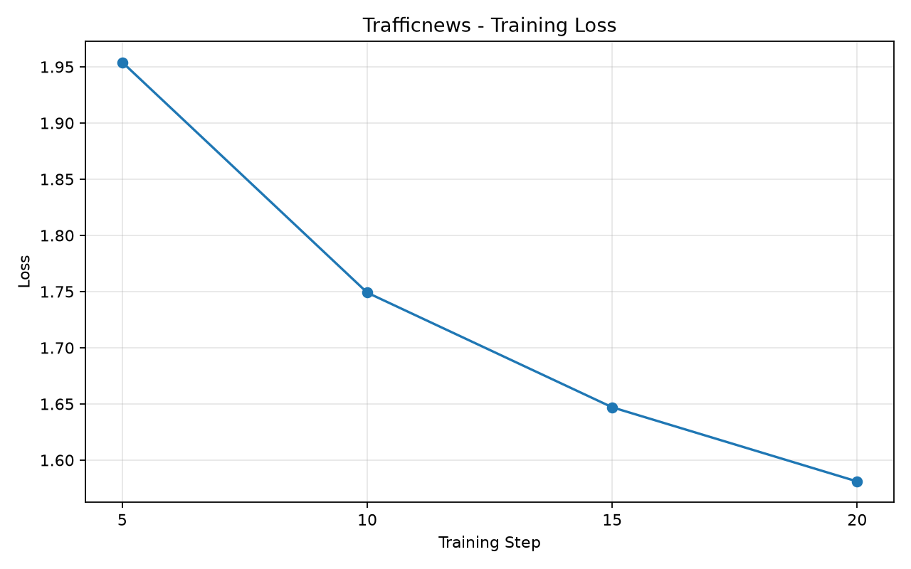
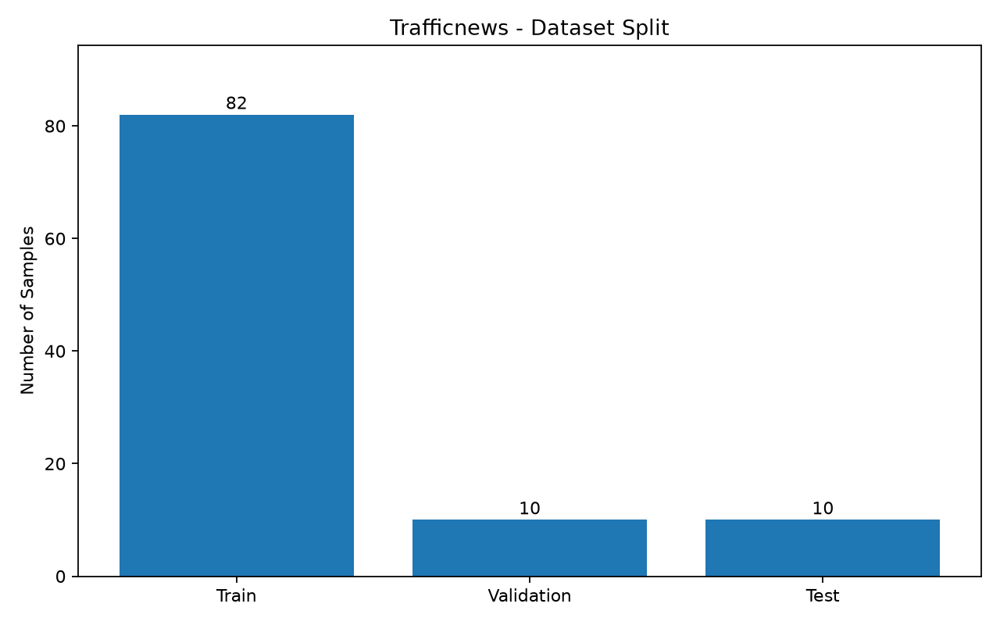
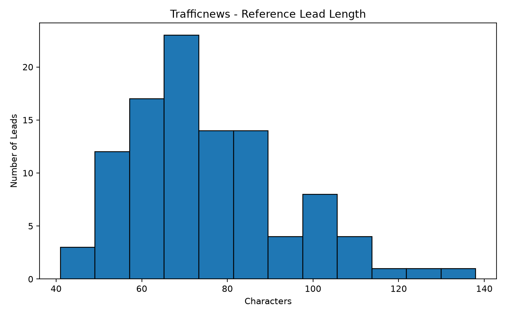

# trafficnews — 교통정보 보도자료 기반 AI 뉴스 리드 생성

## 1. 프로젝트 소개

`trafficnews`는 교통정보 관련 보도자료를 수집하고, 해당 자료를 바탕으로 뉴스기사의 첫 문장인 **리드(Lead)** 를 생성하는 AI 모델을 개발하는 실습 프로젝트입니다.

「AI 기반 데이터 저널리스트 양성 과정」의 크롤링 및 파인튜닝 실습을 목적으로 제작했습니다.

### 주요 작업

1. Python을 이용한 교통정보 보도자료 수집
2. 수집 데이터 정제 및 검토
3. 보도자료 본문과 뉴스 리드의 학습 데이터 구성
4. Qwen2.5-3B-Instruct 모델의 QLoRA 파인튜닝
5. Ollama에 `trafficnews` 모델 등록
6. 기본 모델과 파인튜닝 모델의 출력 비교 및 시각화

## 2. 개발 환경

| 항목 | 환경 |
|---|---|
| 운영체제 | Windows 11 |
| 개발 도구 | Visual Studio Code |
| 터미널 | PowerShell |
| 프로젝트 Python | 3.14.7 |
| 파인튜닝 Python | 3.12.10 |
| 학습 GPU | NVIDIA GeForce RTX 5070 Laptop GPU |
| 기본 언어 모델 | Qwen2.5-3B-Instruct |
| 파인튜닝 방식 | QLoRA |
| 주요 학습 도구 | Unsloth, PyTorch |
| 로컬 모델 실행 | Ollama |
| 데이터 처리 및 시각화 | pandas, Matplotlib |

기존 프로젝트 환경과 파인튜닝 환경을 분리하여 사용했습니다.

## 3. 데이터 수집 및 정제

교통정보 관련 보도자료를 수집한 후, 뉴스 리드 생성에 사용할 데이터를 정리했습니다.

### 데이터 처리 과정

1. 보도자료 수집
2. 본문 추출 및 정제
3. 불필요한 정보와 형식 확인
4. 보도자료에 대응하는 리드 작성 및 검토
5. 학습용 입력·정답 데이터 생성
6. 학습·검증·시험 데이터 분할

수집한 보도자료는 총 108건이며, 최종 학습 데이터는 102쌍으로 구성했습니다.

**데이터 1쌍의 구성**

- 입력(Input): 교통정보 보도자료 본문
- 정답(Output): 보도자료의 핵심 내용을 요약한 뉴스기사 첫 문장

날짜, 수치, 기관명, 지명 등 핵심 사실이 원문과 일치하는지 확인하는 것을 데이터 검토 원칙으로 삼았습니다.

단, 전체 데이터의 원문 대조 및 AI 학습·재배포 권한 검토가 모두 완료됐다는 의미는 아닙니다.

## 4. 학습 데이터 구성

| 구분 | 데이터 수 |
|---|---:|
| 학습(Train) | 82 |
| 검증(Validation) | 10 |
| 시험(Test) | 10 |
| 합계 | 102 |

학습 데이터는 모델을 학습하는 데 사용하고, 검증 데이터는 학습 상태를 확인하는 데 사용했습니다.

시험 데이터 10건은 기본 모델과 파인튜닝 모델을 비교하는 용도로 구분했습니다.

데이터는 JSONL 형식으로 구성했습니다.

- `trafficnews_train.jsonl`
- `trafficnews_validation.jsonl`
- `trafficnews_test.jsonl`

**주의:** 데이터 원문에 대한 공개·재배포 가능 여부가 확정되지 않아 JSONL 및 CSV 파일은 GitHub 업로드 대상에서 제외했습니다.

## 5. 모델 파인튜닝

### 기본 모델

`unsloth/Qwen2.5-3B-Instruct-bnb-4bit`

### 학습 방식

QLoRA를 활용했습니다. QLoRA는 대형 언어 모델 전체를 다시 학습하는 대신 일부 추가 가중치를 학습하여 GPU 메모리 사용량을 줄이는 방법입니다.

### 실제 학습 결과

| 항목 | 결과 |
|---|---|
| 학습 데이터 | 82건 |
| 검증 데이터 | 10건 |
| Epoch | 1 |
| 학습 Step | 21 |
| 최종 기록된 학습 손실 | 약 1.732 |
| 검증 손실 | 약 1.576 |
| LoRA 학습 파라미터 | 14,966,784개 |

학습 손실(Loss)은 모델의 예측과 학습 정답 사이의 차이를 나타내는 지표로, 낮을수록 학습 데이터에 대한 오차가 작다는 의미입니다.

단, 손실 감소가 기사 내용의 사실 정확성 향상을 자동으로 보장하지는 않습니다.

## 6. Ollama 로컬 모델 등록

파인튜닝 결과를 GGUF 형식으로 변환하고 Q4_K_M 방식으로 양자화했습니다.

생성된 모델 파일을 이용해 Ollama에 `trafficnews`라는 이름으로 등록했습니다.

### 등록 확인

```powershell
ollama list
```

실제 확인 결과 `trafficnews:latest`가 모델 목록에 등록됐습니다.

### 모델 실행

```powershell
ollama run trafficnews
```

보도자료를 입력하여 뉴스 리드를 생성하는 동작을 확인했습니다.

다만 실제 네트워크 연결을 차단한 상태에서의 오프라인 실행 검증은 별도로 확인해야 합니다.

**참고:** GGUF 모델과 LoRA 가중치는 파일 크기 등의 이유로 이 GitHub 저장소에 포함하지 않습니다. 따라서 저장소만 복제해 `trafficnews` 모델을 즉시 실행할 수는 없습니다.

## 7. 기본 모델과 파인튜닝 모델 비교

동일한 시험 데이터 10건을 이용하여 다음 두 모델의 뉴스 리드를 생성했습니다.

- 기본 모델: `qwen2.5:3b`
- 파인튜닝 모델: `trafficnews`

모델 비교에는 로컬 Ollama API를 사용했습니다.

두 모델에 같은 입력과 생성 옵션을 적용하여 결과를 수집했습니다.

### 비교 평가 기준

1. 보도자료의 핵심 사실을 반영했는가?
2. 원문에 없는 수치나 날짜를 추가하지 않았는가?
3. 원문에서 확인되지 않은 원인이나 전망을 만들어내지 않았는가?
4. 뉴스기사의 첫 문장으로 자연스러운가?

두 모델의 출력 10건씩을 CSV로 저장했습니다.

**현재 평가 상태:** 출력 생성은 완료됐으나 사람의 사실 정확성 판정은 진행 전입니다. 따라서 어느 모델이 더 정확하다고 단정하지 않습니다.

## 8. 데이터 시각화

실습 과정에서 다음 그래프 3개를 생성했습니다.

### 학습 손실 변화



학습 단계별 Loss 변화를 표시한 선그래프입니다. 학습 과정에서 기록된 손실 변화 추이를 확인할 수 있습니다.

### 학습 데이터 분할



전체 102쌍의 데이터를 학습 82건, 검증 10건, 시험 10건으로 나눈 구성을 보여줍니다.

### 정답 리드 길이 분포



102개 정답 리드의 글자 수 분포를 보여주는 히스토그램입니다.

## 9. 주요 소스 코드

| 파일 | 역할 |
|---|---|
| `trafficnews_crawler.py` | 보도자료 수집 |
| `trafficnews_pdf_extract.py` | PDF 텍스트 추출 |
| `trafficnews_clean.py` | 수집 데이터 정제 |
| `trafficnews_normalize.py` | 텍스트 형식 정리 |
| `trafficnews_finalize.py` | 정제 데이터 최종 처리 |
| `trafficnews_make_pairs.py` | 입력·정답 데이터 구성 |
| `trafficnews_verify.py` | 데이터 비교 검증 |
| `trafficnews_model_evaluation.py` | 두 모델 비교 및 그래프 생성 |
| `trafficnews_crawling.ipynb` | 크롤링 실습 노트북 |
| `trafficnews_data_preparation.ipynb` | 학습 데이터 준비 실습 노트북 |
| `trafficnews_finetune.py` | QLoRA 파인튜닝 재현용 코드 및 학습 데이터 검사 |

## 10. 실행 및 재현 시 주의사항

이 저장소에는 실습에 사용한 소스 코드와 결과 그래프를 공개합니다.

Python 실행 환경을 준비한 후 각 스크립트의 필요한 패키지와 입력 파일을 별도로 준비해야 합니다.

일부 전처리 코드는 이전 단계에서 생성한 CSV를 입력으로 사용합니다. 현재 CSV·JSONL 및 원본 PDF는 저장소에서 제외되므로, 전체 수집·전처리·학습 과정을 저장소만으로 즉시 재현할 수는 없습니다.

모델 비교 코드는 다음 조건에서 실행했습니다.
### 파인튜닝 재현 코드 안내

`trafficnews_finetune.py`는 실제 학습에 사용한 원본 코드가 아니라, 확인된 학습 설정을 바탕으로 재구성한 코드입니다.

기본 실행에서는 학습 데이터 82건과 검증 데이터 10건을 확인하며, 모델 학습을 시작하지 않습니다. 이 데이터 검사 동작은 정상 실행을 확인했습니다.

`--train` 옵션을 사용하면 별도의 재현 학습을 시작하도록 설계했으나, 실제 학습 실행은 검증하지 않았습니다. 일부 하이퍼파라미터는 원본 학습 설정과 다를 수 있으므로 동일한 학습 결과를 보장하지 않습니다.

- 로컬 Ollama 서버 실행
- `qwen2.5:3b` 모델 설치
- 파인튜닝된 `trafficnews` 모델 등록
- 시험 데이터 JSONL 파일 준비
- Python 실행 환경에 Matplotlib 설치

실행 명령어:

```powershell
.\.venv-train\Scripts\python.exe .\trafficnews_model_evaluation.py
```

이 명령어는 기존 실습 환경에서 사용한 방식입니다. 새 PC에서는 별도의 가상환경 설치와 모델 준비가 필요합니다.

또한 결과 파일이 이미 존재하면 코드가 덮어쓰기를 방지하기 위해 실행을 중단합니다.

## 11. AI 저널리즘 윤리 및 한계

AI가 작성한 뉴스 리드에는 원문에 없는 내용이 포함될 수 있습니다.

실제 모델 시험에서도 날짜 표현의 변경이나 원문에 없는 원인 관련 표현이 나타난 사례가 확인됐습니다.

따라서 다음 원칙을 적용합니다.

- AI 생성 문장은 최종 뉴스기사로 바로 사용하지 않습니다.
- 날짜·수치·기관명·지명을 원문과 대조합니다.
- 보도자료에 없는 인과관계와 전망을 임의로 추가하지 않습니다.
- 정부기관의 발표와 객관적으로 검증된 사실을 구분합니다.
- 개인정보와 저작권을 확인합니다.
- 사람이 최종적으로 검수한 뒤 사용 여부를 결정합니다.

**이 프로젝트는 뉴스 리드 생성 모델의 학습 및 실행을 검증한 실습 결과이며, 기사 사실 정확성을 보장하는 시스템은 아닙니다.**

## 12. 향후 검증 과제

- 시험 데이터 10건에 대한 모델별 사람 검수 완료
- 보도자료 원문과 학습 데이터의 전수 대조
- 학습 데이터 이용 및 공개 권한 확인
- 네트워크 연결을 차단한 Ollama 오프라인 실행 검증
- 전체 학습 과정의 재현을 위한 환경 및 실행 코드 보완

## 13. 프로젝트 정보

- 프로젝트 이름: `trafficnews`
- GitHub 계정: `gamzpot96-cell`
- 목적: AI 기반 데이터 저널리즘 교육 실습
- 핵심 기능: 교통정보 보도자료 기반 뉴스 리드 생성
